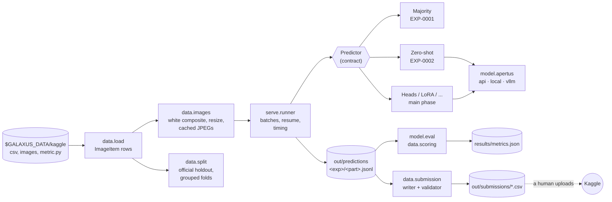
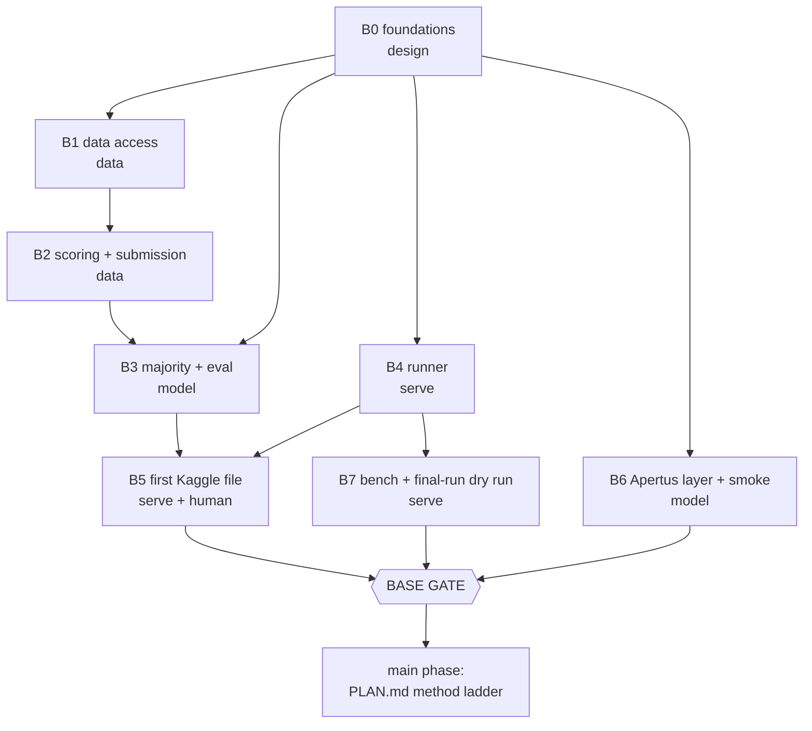

# BASE_ARCHITECTURE.md: the base every method plugs into

Team NoIdea, draft by design for review. It builds on PLAN.md (branch `design/3-plan`): PLAN.md says *which methods*
we try; this file says *what has to exist first* so that every method is just one more `Predictor`. Rules, numbers and
class names are not restated here: they live in [challenge_description.md](challenge_description.md),
[FAQ.md](FAQ.md) and [AGENTS.md](AGENTS.md).

**The base is done when the majority baseline (EXP-0001) runs through the same code path as the final Saturday run:
load → prepare → predict → score → write → validate → Kaggle.** After that, the main methods (zero-shot, heads, LoRA,
ensembles) only add a predictor and never touch the pipeline.

## 1. Architecture



Three ideas carry the whole design:

1. **One contract.** `Predictor.predict(list[ImageItem]) -> list[Prediction]`. Majority, zero-shot, heads, LoRA and
   ensembles all implement it, so the runner, eval, benchmark and Saturday script never change.
2. **One runner for everything.** The holdout, dev and final images go through the same `serve.runner`, so the
   Saturday run is a run we have already done many times on dev.
3. **One Apertus layer with three backends.** `api` (Keera gateway), `local` (transformers on CUDA, Apple MPS or CPU)
   and `vllm` (GPU). The `local` backend also returns hidden states, which the heads method needs; `api` cannot.

## 2. Repository layout

Matches the lanes in [AGENTS.md](AGENTS.md); `ci` already enforces them.

```
pyproject.toml, uv.lock, justfile, .env.example     design
contracts/classes.json, prediction.md, experiment.md design (read-only for lanes)
src/galaxus/types.py                                 design: ImageItem, Prediction, Predictor protocol
src/galaxus/data/                                    data lane
    paths.py        the $GALAXUS_DATA layout (section 3)
    load.py         train / dev / final csv → ImageItem (context may be None)
    images.py       transparency onto white, resize to a target area with sides a multiple of 32, JPEG, cache
    split.py        the official holdout + folds grouped by product_id
    scoring.py      scored-cell mask, wrapper around metric.py loaded from $GALAXUS_DATA at runtime
    submission.py   writer in sample_submission order + validator
src/galaxus/model/                                   model lane
    baselines.py    MajorityPredictor
    apertus/        backend.py (interface), api.py, local.py, vllm.py
    prompts.py, parse.py
    eval.py         predictor × holdout → one EXP row in results/metrics.json
src/galaxus/serve/                                   serve lane
    runner.py       batches any Predictor over a part, writes jsonl, resumes, times
    bench.py        img/s, peak memory, cost per 100k images
    final_run.py    passphrase (getpass) → decrypt → runner → merge with best dev file → validate → submit command
tests/{data,model,serve}/                            synthetic images only, no data, no network
results/metrics.json                                 generated by model.eval only
```

## 3. Data layout (outside git)

```
$GALAXUS_DATA/
    kaggle/                  the competition download, untouched
    final/                   decrypted on Saturday
    cache/images/<size>/     prepared JPEGs, one per image
    cache/features/<exp>/    hidden states (main phase, heads)
    out/predictions/<exp>/   <part>.jsonl, one line per image
    out/submissions/         validated csv files, ready for a human to upload
    out/label_errors.csv     never committed, a human sends it
```

## 4. Workflow

Each step is one issue in one lane, so each becomes one PR. **B0 comes first; after it the three lanes run in
parallel.** A step is done only when its "done when" holds.

### Who does which PR (proposed; the AGENTS.md roles table stays `TODO(owner)` until Neel confirms)

| Person | GitHub | Lane | PRs | Also |
| --- | --- | --- | --- | --- |
| Neel | neelshah261 | design (owner) | B0 | Kaggle team + download + SHA check, the B5 upload, Discord questions, GPU access |
| Swarup | swarupgaikwad1801-ux | data | B1, B2 | label-error finder in the main phase |
| Parth | deshmukhparth921-commits | model | B3, B6 | heads / LoRA in the main phase |
| Varika | vernikas-ctrl | serve | B4, B5 (file + command), B7 | benchmark numbers, diagram, deck and demo video |



### B0 · Foundations (design)
- `pyproject.toml` + `uv.lock`, Python 3.12. Core deps stay light (pandas, numpy, pillow, scikit-learn, pytest);
  heavy ones are extras so `ci` stays fast: `local` (torch, transformers), `api` (an OpenAI-compatible client),
  `gpu` (vllm).
- `.env.example` with `LLM_NAME`, `LLM_BASE_URL`, `LLM_API_KEY` (as the [README](README.md) asks) and `GALAXUS_DATA`.
- `justfile`: `setup`, `test`, `prep`, `eval <predictor>`, `run <predictor> <part>`, `bench`, `final --dry-run`.
- `src/galaxus/types.py` and `contracts/` exactly as PLAN.md "Lanes and contracts" describes; `classes.json`
  copied verbatim from challenge_description.md "Classes".
- Stubs: MODELS.md, decisions.md (Q-0001 to Q-0006 from PLAN.md, plus Q-0007 below), STATE.md, worklog.md.
- **Add a `pytest` step to `ci`.** Today `ci` only runs the lane and data-leak check.
- **Done when:** `uv sync && uv run pytest` is green locally and in `ci`, and every lane can import `galaxus.types`.

### B1 · Data access (data)
- Download: the owner runs the Kaggle CLI into `$GALAXUS_DATA/kaggle/` and checks the SHA-256 of the encrypted final
  file against the Kaggle data page; also check that `7z x` (`7zz` on a Mac) asks for a passphrase.
- `load.py`, `paths.py`, `images.py`. The white compositing follows the reference notebook (`opaque_rgb_on_white`);
  image size and JPEG quality come from one config so training and prediction always see the same pixels.
- `split.py`: the fixed holdout from challenge_description.md "Scoring locally" (AGENTS.md product rule 1), plus
  folds grouped by product_id for cross-validation on the rest of train.
- **Done when:** tests on a synthetic transparent image give a white background and sides that are multiples of 32;
  the split is identical on every run; `just prep` fills the image cache.

### B2 · Scoring and submission (data)
- `scoring.py`: builds the solution frame (human label and relevant, otherwise empty) and calls metric.py
  `score` / `evaluate` from `$GALAXUS_DATA`.
- `submission.py`: writer that keeps the ids and order of sample_submission.csv and keeps the constant final rows
  until final predictions exist; validator for missing ids, empty cells, unknown classes and a capitalised `None`.
- **Done when:** tests with a fake metric and a synthetic sample submission pass, and the validator rejects each bad
  case on its own.

### B3 · Majority predictor and eval harness (model)
- `MajorityPredictor`: the most frequent human label per dimension on train minus the holdout.
- `eval.py`: runs any predictor on the holdout through the runner, scores it, appends one EXP row (fields from
  `contracts/experiment.md`) to `results/metrics.json`.
- Can start on B0 with fakes; needs B2 to produce a real score.
- **Done when:** EXP-0001 is in `results/metrics.json`, written by the script, not by hand.

### B4 · Runner (serve)
- `runner.py`: batches `ImageItem`s through any predictor, appends one jsonl line per image, skips ids already
  written (resume after a crash), records images per second.
- **Done when:** the `ci` smoke test (3 synthetic images → predictions → validated file) passes, and killing a run
  halfway and starting it again finishes without duplicates.

### B5 · First Kaggle file (serve + a human)
- `just run majority dev` → writer → validator → the exact `kaggle competitions submit` command, printed.
- The owner runs the command (AGENTS.md product rule 7: agents never upload).
- **Done when:** a valid file has a public score on Kaggle. From here on, a valid file is always on Kaggle.

### B6 · Apertus layer and smoke test (model)
- `backend.py`: one interface with `generate(messages, images, json_schema)` for all backends and
  `forward(images, prompt) → hidden states` for `local` only.
- `api.py` (Keera, from the `LLM_*` variables), `local.py` (device picked automatically: cuda, mps or cpu),
  `vllm.py` (the swiss-ai vLLM image on the Hack Apertus GPU).
- A smoke script with one synthetic image answers Q-0001 (does the gateway take images?), Q-0002 (JSON-schema output,
  tokens per image) and Q-0006 (which transformers version loads Apertus 1.5), and measures forward-pass images per
  second on the Mac and on the GPU.
- **Done when:** the answers are in the PR's "For design" notes, and at least one backend generates and one returns
  hidden states.

### B7 · Benchmark and final-run dry run (serve)
- `bench.py`: images per second, peak memory (CUDA or MPS), cost per 100k images with the formula in PLAN.md "Speed".
- `final_run.py`: asks for the passphrase with getpass (never stored), decrypts into `$GALAXUS_DATA/final/`, runs the
  runner, merges the final rows into the best dev file, validates, prints the submit command. `--dry-run` treats dev
  as if it were final.
- **Done when:** `just final --dry-run` with the majority predictor ends in a validated file, timed.

## 5. Base gate: all must hold before the main phase

- [ ] `ci` green with tests, and no data or network in any test
- [ ] EXP-0001 in `results/metrics.json`
- [ ] a valid file on Kaggle
- [ ] Apertus smoke test passed; Q-0001, Q-0002 and Q-0006 answered
- [ ] `final_run.py --dry-run` green on dev
- [ ] the Discord questions are asked (owner): Q-0003, and Q-0007 below

## 6. What the main phase adds (and nothing else)

Each is a new predictor or wrapper in the model lane, scored by the same `eval.py`:

| Adds | Needs from the base |
| --- | --- |
| Zero-shot Apertus (EXP-0002) | `apertus.api` or `apertus.vllm`, `prompts.py`, `parse.py` |
| Features + heads | `apertus.local.forward`, `cache/features/`, the grouped folds of `split.py` |
| LoRA (EXP-0004) | `images.py` config shared with training, `apertus.vllm` for serving, the Hack Apertus GPU |
| Calibration, mirror TTA, ensembles | `Prediction.confidence`, the runner |
| Label-error finder | out-of-fold predictions from the grouped folds |

## 7. New open question

| ID | Question | How |
| --- | --- | --- |
| Q-0007 | Do small classification heads on Apertus v1.5 hidden states count as "Apertus classifying"? The Hack Apertus resources page lists "Apertus Probe" (linear probes on Apertus activations) as a resource. | Discord (owner) |
