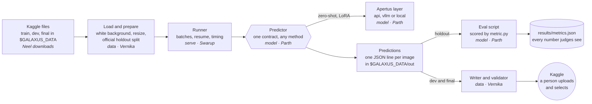
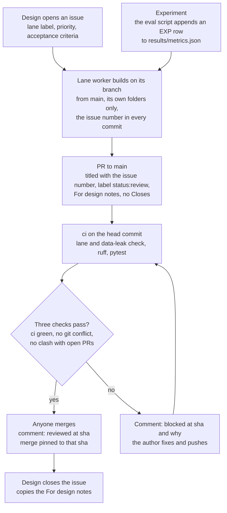

# BUILD_PLAN.md: base, main method, one innovation

Team NoIdea. **Decided by Parth, 2026-11-27:** build the base first, then the main method, then one innovation.
How the work moves is in [Workflow](#workflow); who builds which PR next, one at a time, is in [#50](https://github.com/neelshah261/NoIdea-galaxus/issues/50). The rules, numbers and class names live in
[challenge_description.md](challenge_description.md), [FAQ.md](FAQ.md) and [AGENTS.md](AGENTS.md); this file only
plans. The methods are PLAN.md's ([PLAN.md](PLAN.md)); the base steps are BASE_ARCHITECTURE.md's
([BASE_ARCHITECTURE.md](BASE_ARCHITECTURE.md)).

> **Open: [#40](https://github.com/neelshah261/NoIdea-galaxus/issues/40) proposes a different main method.** Both
> versions stay side by side under [Open decision](#open-decision-this-plan-or-40) until Neel decides with the
> hosts' answer to Q-0007 (AGENTS.md, "Hard rules": never silently pick a winner).

## Must deliver by Sat 28 Nov, 14:30 CET

Six hand-ins are due at 14:30 ([challenge_description.md, "What you hand in"](challenge_description.md#what-you-hand-in)),
and five rules decide whether the score counts. The pitch is at 15:00: 7 minutes plus 2 of questions.

- [ ] Kaggle submission with the final-image predictions, uploaded by about 14:15 and **selected** for the final ranking
- [ ] Public repo in the template layout that a judge can run end to end
- [ ] Technical report as a PDF, at most 6 pages without references, `TeamName_Report.pdf` in the repo root, section 7 filled in
- [ ] Demo video of at most 2 minutes, linked at the top of `technical_report.md`
- [ ] Pitch deck of at most 10 slides
- [ ] Weights published with their revision named in section 7 (only if we change Apertus)
- [ ] Bonus: suspected label errors in train.csv as a CSV, sent by direct message to the Galaxus hosts, never committed

Rules that gate the score:

- Apertus v1.5 classifies; at runtime only Apertus and open-weights helpers such as OCR or an image encoder.
- No hand-labelling of dev or final images, no product lookups, and the final images are for inference only.
- Reproducible from the named commit and weights: Galaxus may rerun it, and a score that leaves its group can be disqualified.
- At least 2 images per second on Saturday, so the 5,292 final images finish in about 45 minutes.
- No competition data, labels or passphrase in the repo or in the weights.

## Base architecture

The runner hands the same items to whichever predictor is registered, so moving from the majority baseline to an
Apertus method changes one box. Every score goes through metric.py into `results/metrics.json`, and every Kaggle
file passes the validator first.

## Phase 1: the base

The base code is on `main`; what is left of the base gate needs people: the Kaggle files, the gateway key, a
Kaggle upload.

| Step | What it builds | Lane, owner | Issue | PR | Status |
| --- | --- | --- | --- | --- | --- |
| B0 | `galaxus.types`, contracts, justfile, extras, state files | design, Neel | [#11](https://github.com/neelshah261/NoIdea-galaxus/issues/11) | | open |
| B1 | image loader, white compositing, resize | data, Vernika | [#4](https://github.com/neelshah261/NoIdea-galaxus/issues/4) | [#20](https://github.com/neelshah261/NoIdea-galaxus/pull/20), [#24](https://github.com/neelshah261/NoIdea-galaxus/pull/24) | merged |
| B2 | official holdout split, scored-cell mask, metric wrapper, submission writer + validator | data, Vernika | [#5](https://github.com/neelshah261/NoIdea-galaxus/issues/5), [#6](https://github.com/neelshah261/NoIdea-galaxus/issues/6) | [#20](https://github.com/neelshah261/NoIdea-galaxus/pull/20) | merged |
| B3 | majority baseline + eval script | model, Parth | [#12](https://github.com/neelshah261/NoIdea-galaxus/issues/12) | [#22](https://github.com/neelshah261/NoIdea-galaxus/pull/22) | merged |
| B4 | batched runner with resume and timing | serve, Swarup | [#14](https://github.com/neelshah261/NoIdea-galaxus/issues/14) | [#19](https://github.com/neelshah261/NoIdea-galaxus/pull/19) | merged |
| B5 | first Kaggle file + the submit command | serve, Swarup; Neel uploads | [#15](https://github.com/neelshah261/NoIdea-galaxus/issues/15) | [#19](https://github.com/neelshah261/NoIdea-galaxus/pull/19) | merged |
| B6 | Apertus layer (api, vllm, local) + smoke test | model, Parth | [#13](https://github.com/neelshah261/NoIdea-galaxus/issues/13), [#38](https://github.com/neelshah261/NoIdea-galaxus/issues/38) | [#22](https://github.com/neelshah261/NoIdea-galaxus/pull/22), [#44](https://github.com/neelshah261/NoIdea-galaxus/pull/44) | merged |
| B7 | benchmark + final-run dry run | serve, Swarup | [#16](https://github.com/neelshah261/NoIdea-galaxus/issues/16) | [#19](https://github.com/neelshah261/NoIdea-galaxus/pull/19) | merged |
| Bonus | label-error finder | data, Vernika | [#7](https://github.com/neelshah261/NoIdea-galaxus/issues/7) | [#20](https://github.com/neelshah261/NoIdea-galaxus/pull/20), [#24](https://github.com/neelshah261/NoIdea-galaxus/pull/24) | merged |

The phase ends at the base gate of BASE_ARCHITECTURE.md:

- [x] The three lanes merged into `main`
- [ ] EXP-0001 in `results/metrics.json`: `uv run python -m galaxus.model.eval majority --exp-id EXP-0001` (needs the Kaggle files)
- [ ] A valid file with a public score on Kaggle (B5; a person uploads)
- [ ] The smoke test run on the gateway: `uv run --env-file .env python -m galaxus.model.apertus.smoke --backend api` (Neel runs it where the keys are: [#46](https://github.com/neelshah261/NoIdea-galaxus/issues/46))
- [ ] The final-run dry run green on dev (B7)

## Phase 2: the main method

Zero-shot Apertus 8B shows how far prompting gets; a LoRA on Apertus 8B is the likely way into the top group. The
bar on dev: finetuned Qwen 3.5 9B 0.917, Gemini 3.8 Flash 0.806 ([Baselines](challenge_description.md#baselines)).

1. **EXP-0002, zero-shot Apertus v1.5 8B** ([#47](https://github.com/neelshah261/NoIdea-galaxus/issues/47)) through the B6 layer: labeling guideline in the system prompt, one call
   per image, a JSON answer held to the class lists, thinking off, greedy, image about 512×512 on white. Run once
   with product context and once without.
2. **EXP-0004, LoRA on Apertus 8B** ([#49](https://github.com/neelshah261/NoIdea-galaxus/issues/49)), adapted from the reference notebook: loss on human labels only, rare-class
   repeats, mirrored copies, bf16 LoRA, merged and served with vLLM. Trained without the holdout. PLAN.md estimates
   2.5–4 h on one L40S, about $5–7, so it starts only with Neel's OK.
3. **Pick the main method:** the best holdout score that still runs at 2 images per second or faster; on a near
   tie, the faster one, since speed is 20% of the grade.

For scale: the Galaxus recipe took about 3 h on one L40S and serves 25 images per second there (deep-dive notes,
[#17](https://github.com/neelshah261/NoIdea-galaxus/issues/17)).

## Phase 3: one innovation

Candidates placed by expected gain and by cost and risk (a proposal, by zone only):

| Zone | Candidate | Rules question first |
| --- | --- | --- |
| Do first: high gain, low cost | Mirror TTA for perspective | none |
| Do first: high gain, low cost | Quantized Apertus, for speed | none |
| Do first: high gain, low cost | Product type in the prompt | none |
| Bets: high gain, high cost | Heads on Apertus features | Q-0007 |
| Bets: high gain, high cost | Neighbour label hints from similar train images | Q-0003 |
| Cheap extras: low gain, low cost | Per-class calibration | Q-0005 |
| Later: low gain, high cost | OCR helper for text_language | none |
| Later: low gain, high cost | Closed-model pseudo-labels on dev | the hosts' unclear remark (#17) |

The one innovation comes from the "Do first" zone, since those need no rules answer. The proposal is **mirror TTA
for perspective** ([#48](https://github.com/neelshah261/NoIdea-galaxus/issues/48)): classify the mirrored image too and swap left and right in that answer, aimed at the left/right
mix-ups the hosts showed. It runs as its own EXP row on the same holdout, which also fills the ablation table for
the 15% insights part. A quantized Apertus is measured as a speed row either way (the 20% speed part). The two bets
wait for the hosts' answers to Q-0007 and Q-0003.

## Open decision: this plan or #40

[#40](https://github.com/neelshah261/NoIdea-galaxus/issues/40) (Swarup, waiting for Neel's OK) and this plan
differ on the main method. Both stay until Neel decides; the hosts' answer to Q-0007 settles most of it.

| | This plan | #40 |
| --- | --- | --- |
| Main method | zero-shot Apertus 8B, then a LoRA (EXP-0004) | small heads per dimension on Apertus 8B hidden states, one forward pass at 512 px, no generation |
| Fallback | none needed: the LoRA is the main candidate | the LoRA (EXP-0004), if the heads score too low |
| Innovation | one: mirror TTA for perspective | the heads themselves, plus calibration, mirrored training rows ([#29](https://github.com/neelshah261/NoIdea-galaxus/issues/29)) and an FP8 row |
| Q-0007 (heads count as Apertus classifying?) | gates the heads, a bet here | decides option 1 |
| Image size | about 512×512 | 512 px always |

## Workflow

These are the rules of AGENTS.md "Merging" on `main` since the freeze was lifted
([#9](https://github.com/neelshah261/NoIdea-galaxus/issues/9)). An experiment's EXP row travels the same road as code,
so every number in the report has a commit and a review behind it.

## Decisions

- [x] This plan: the base first, then the main method, then one innovation (Parth, 2026-11-27)
- [x] Merging: the freeze is lifted and PRs target `main` (#9, AGENTS.md)
- [ ] Main method: this plan or #40 (Neel, with the hosts' answer to Q-0007)
- [ ] GPU budget for the LoRA run (Neel; PLAN.md: about $5–7 on one L40S)
- [ ] Discord questions (Neel): Q-0003 (label hints from similar train images), Q-0007 (heads on Apertus features), and the unclear remark on dev pseudo-labels from the deep dive
- [ ] The smoke test on the gateway, run where the keys are (Neel, [#46](https://github.com/neelshah261/NoIdea-galaxus/issues/46))

## Sources

- [challenge_description.md](challenge_description.md): task, model rules, timeline, evaluation, hand-ins and how Galaxus assesses
- [FAQ.md](FAQ.md): compute credits, submissions, the final 90 minutes
- [PLAN.md](PLAN.md): method ladder, open questions Q-0001 to Q-0006, cost estimates
- [BASE_ARCHITECTURE.md](BASE_ARCHITECTURE.md): steps B0 to B7, the base gate, Q-0007
- [AGENTS.md](AGENTS.md): lanes and merge rules
- [#9](https://github.com/neelshah261/NoIdea-galaxus/issues/9): the freeze and how it was lifted
- [#17](https://github.com/neelshah261/NoIdea-galaxus/issues/17): deep-dive notes, transcribed from Swarup's recordings, unofficial
- [#40](https://github.com/neelshah261/NoIdea-galaxus/issues/40): Swarup's plan for Neel's OK
- [Reference notebook](reference/finetune_qwen35_reference.ipynb): the Qwen 3.5 9B recipe with its outputs
