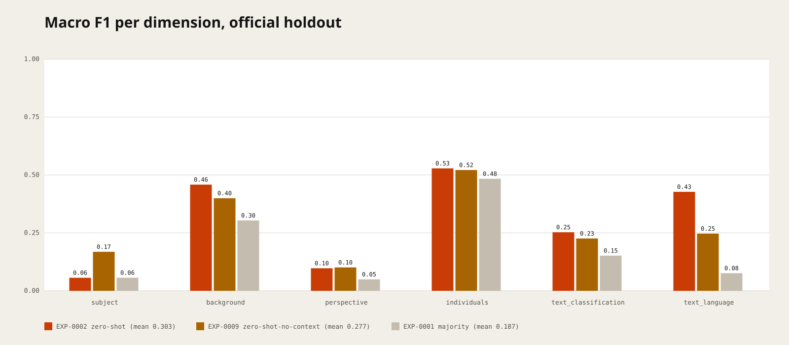

# Results

Generated by `python -m galaxus.serve.results_tables` from `results/metrics.json`; do not edit by hand. Scores are macro F1 on the official holdout (metric.py, human labels only). All rows scored the same holdout.

## All runs

| EXP | Predictor | Mean | subject | background | perspective | individuals | text_classification | text_language | Weighted | img/s | $ / 100k | Commit |
| --- | --- | --- | --- | --- | --- | --- | --- | --- | --- | --- | --- | --- |
| EXP-0001 | majority | **0.187** | 0.056 | 0.304 | 0.049 | 0.484 | 0.152 | 0.076 | 0.579 | n/a (no model) | - | `fdecf942` |
| EXP-0002 | zero-shot | **0.303** | 0.056 | 0.458 | 0.097 | 0.529 | 0.253 | 0.427 | 0.635 | 6.4 | - | `8bf0efe6` |
| EXP-0009 | zero-shot-no-context | **0.277** | 0.168 | 0.400 | 0.101 | 0.521 | 0.226 | 0.247 | 0.623 | 6.6 | - | `8bf0efe6` |
| EXP-0015 | zero-shot | **0.327** | 0.059 | 0.447 | 0.111 | 0.734 | 0.290 | 0.322 | 0.620 | 2.0 | - | `7e71510c` |
| EXP-0014 | zero-shot-image-first | **0.295** | 0.062 | 0.445 | 0.095 | 0.514 | 0.249 | 0.407 | 0.630 | 5.7 | - | `9fc0071d` |
| EXP-0006 | mirror-tta:zero-shot | **0.306** | 0.058 | 0.460 | 0.112 | 0.529 | 0.251 | 0.425 | 0.637 | 2.8 | - | `9fc0071d` |
| EXP-0017 | zero-shot-768 | **0.312** | 0.068 | 0.473 | 0.099 | 0.522 | 0.228 | 0.483 | 0.625 | 3.5 | - | `9fc0071d` |
| EXP-0018 | zero-shot-no-title | **0.296** | 0.060 | 0.453 | 0.097 | 0.522 | 0.254 | 0.389 | 0.636 | 6.5 | - | `9fc0071d` |
| EXP-0019 | zero-shot-macro-aware | **0.306** | 0.059 | 0.471 | 0.100 | 0.529 | 0.246 | 0.430 | 0.636 | 4.7 | - | `9fc0071d` |
| EXP-0021 | zero-shot-observe-first | **0.343** | 0.164 | 0.422 | 0.219 | 0.514 | 0.330 | 0.411 | 0.661 | 4.6 | - | `9fc0071d` |
| EXP-0027 | type-prior | **0.388** | 0.193 | 0.429 | 0.277 | 0.642 | 0.370 | 0.416 | 0.685 | 4.6 | - | `4968ef98` |
| EXP-0024 | zero-shot-observe-first-768 | **0.341** | 0.117 | 0.398 | 0.168 | 0.522 | 0.321 | 0.519 | 0.640 | 2.1 | - | `4968ef98` |
| EXP-0025 | zero-shot-observe-first-no-context | **0.360** | 0.233 | 0.393 | 0.218 | 0.514 | 0.302 | 0.500 | 0.668 | 4.6 | - | `4968ef98` |
| EXP-0029 | type-prior | **0.393** | 0.235 | 0.394 | 0.278 | 0.642 | 0.336 | 0.471 | 0.686 | 4.6 | - | `0ea10293` |
| EXP-0043 | ensemble-agree | **0.365** | 0.233 | 0.414 | 0.218 | 0.506 | 0.318 | 0.500 | 0.668 | 2.3 | - | `0ea10293` |
| EXP-0038 | zero-shot-per-dimension | **0.270** | 0.059 | 0.451 | 0.109 | 0.522 | 0.223 | 0.259 | 0.563 | 2.9 | - | `08ca84a1` |
| EXP-0039 | zero-shot-per-dimension-observe-first | **0.334** | 0.169 | 0.392 | 0.221 | 0.550 | 0.293 | 0.378 | 0.638 | 1.5 | - | `08ca84a1` |
| EXP-0041 | zero-shot-per-dimension-observe-first-no-context | **0.380** | 0.248 | 0.422 | 0.224 | 0.529 | 0.298 | 0.559 | 0.668 | 1.6 | - | `08ca84a1` |
| EXP-0044 | ensemble-agree | **0.368** | 0.233 | 0.422 | 0.207 | 0.514 | 0.330 | 0.500 | 0.666 | 2.3 | - | `3e94f21a` |
| EXP-0045 | type-prior | **0.403** | 0.235 | 0.429 | 0.268 | 0.642 | 0.370 | 0.471 | 0.688 | - | - | `3e94f21a` |
| EXP-0046 | type-prior | **0.416** | 0.255 | 0.419 | 0.294 | 0.632 | 0.333 | 0.564 | 0.693 | - | - | `3e94f21a` |
| EXP-0047 | recalibrated | **0.383** | 0.254 | 0.429 | 0.253 | 0.529 | 0.321 | 0.511 | 0.679 | - | - | `8fb1a412` |
| EXP-0048 | type-prior | **0.416** | 0.251 | 0.423 | 0.312 | 0.632 | 0.361 | 0.517 | 0.699 | - | - | `8fb1a412` |
| EXP-0049 | zero-shot-observe-first-no-context | **0.461** | 0.253 | 0.483 | 0.268 | 0.721 | 0.389 | 0.655 | 0.708 | 2.4 | - | `0ea10293` |
| EXP-0050 | type-prior | **0.431** | 0.270 | 0.444 | 0.324 | 0.648 | 0.334 | 0.564 | 0.705 | - | - | `3786ded4` |
| EXP-0051 | type-prior | **0.489** | 0.303 | 0.494 | 0.324 | 0.762 | 0.415 | 0.637 | 0.729 | - | - | `3786ded4` |
| EXP-0052 | type-prior | **0.400** | 0.235 | 0.411 | 0.306 | 0.642 | 0.334 | 0.471 | 0.692 | 4.6 | - | `3786ded4` |
| EXP-0055 | helper-siglip | **0.705** | 0.702 | 0.878 | 0.520 | 0.977 | 0.667 | 0.486 | 0.861 | 30.3 | - | `ae59d53d` |
| EXP-0056 | ensemble-agree | **0.733** | 0.702 | 0.878 | 0.520 | 0.977 | 0.666 | 0.656 | 0.865 | - | - | `3786ded4` |
| EXP-0057 | type-prior | **0.729** | 0.703 | 0.878 | 0.521 | 0.977 | 0.627 | 0.668 | 0.863 | - | - | `3786ded4` |

## What each change did

| EXP | Changes | Basis | Mean gain | subject | background | perspective | individuals | text_classification | text_language |
| --- | --- | --- | --- | --- | --- | --- | --- | --- | --- |
| EXP-0001 | - | first run on this holdout | - | - | - | - | - | - | - |
| EXP-0002 | EXP-0001 | previous run, same holdout | **+0.117** | +0.000 | +0.155 | +0.048 | +0.045 | +0.101 | +0.351 |
| EXP-0009 | EXP-0002 | previous run, same holdout | **-0.026** | +0.112 | -0.059 | +0.003 | -0.007 | -0.027 | -0.181 |
| EXP-0015 | EXP-0009 | previous run, same holdout | **+0.050** | -0.110 | +0.047 | +0.010 | +0.213 | +0.064 | +0.075 |
| EXP-0014 | EXP-0015 | previous run, same holdout | **-0.032** | +0.003 | -0.002 | -0.016 | -0.220 | -0.040 | +0.085 |
| EXP-0006 | EXP-0014 | previous run, same holdout | **+0.010** | -0.004 | +0.015 | +0.018 | +0.014 | +0.001 | +0.018 |
| EXP-0017 | EXP-0006 | previous run, same holdout | **+0.006** | +0.010 | +0.013 | -0.013 | -0.007 | -0.022 | +0.058 |
| EXP-0018 | EXP-0017 | previous run, same holdout | **-0.016** | -0.007 | -0.020 | -0.002 | +0.000 | +0.026 | -0.094 |
| EXP-0019 | EXP-0018 | previous run, same holdout | **+0.010** | -0.001 | +0.018 | +0.003 | +0.007 | -0.008 | +0.041 |
| EXP-0021 | EXP-0019 | previous run, same holdout | **+0.037** | +0.105 | -0.050 | +0.119 | -0.015 | +0.083 | -0.019 |
| EXP-0027 | EXP-0021 | previous run, same holdout | **+0.045** | +0.029 | +0.008 | +0.058 | +0.128 | +0.040 | +0.006 |
| EXP-0024 | EXP-0027 | previous run, same holdout | **-0.047** | -0.076 | -0.032 | -0.109 | -0.120 | -0.049 | +0.103 |
| EXP-0025 | EXP-0024 | previous run, same holdout | **+0.019** | +0.117 | -0.005 | +0.050 | -0.008 | -0.019 | -0.020 |
| EXP-0029 | EXP-0025 | previous run, same holdout | **+0.033** | +0.002 | +0.001 | +0.060 | +0.128 | +0.034 | -0.029 |
| EXP-0043 | EXP-0029 | previous run, same holdout | **-0.028** | -0.002 | +0.020 | -0.060 | -0.136 | -0.018 | +0.029 |
| EXP-0038 | EXP-0043 | previous run, same holdout | **-0.095** | -0.174 | +0.037 | -0.109 | +0.015 | -0.095 | -0.241 |
| EXP-0039 | EXP-0038 | previous run, same holdout | **+0.063** | +0.110 | -0.059 | +0.112 | +0.028 | +0.070 | +0.120 |
| EXP-0041 | EXP-0039 | previous run, same holdout | **+0.046** | +0.080 | +0.030 | +0.004 | -0.021 | +0.005 | +0.180 |
| EXP-0044 | EXP-0041 | previous run, same holdout | **-0.012** | -0.015 | +0.000 | -0.017 | -0.015 | +0.032 | -0.059 |
| EXP-0045 | EXP-0044 | previous run, same holdout | **+0.035** | +0.002 | +0.008 | +0.061 | +0.128 | +0.040 | -0.029 |
| EXP-0046 | EXP-0045 | previous run, same holdout | **+0.014** | +0.020 | -0.011 | +0.026 | -0.010 | -0.037 | +0.093 |
| EXP-0047 | EXP-0046 | previous run, same holdout | **-0.033** | -0.001 | +0.010 | -0.041 | -0.103 | -0.012 | -0.053 |
| EXP-0048 | EXP-0047 | previous run, same holdout | **+0.033** | -0.003 | -0.006 | +0.059 | +0.103 | +0.040 | +0.007 |
| EXP-0049 | EXP-0048 | previous run, same holdout | **+0.045** | +0.001 | +0.060 | -0.044 | +0.089 | +0.028 | +0.137 |
| EXP-0050 | EXP-0049 | previous run, same holdout | **-0.031** | +0.018 | -0.039 | +0.056 | -0.073 | -0.056 | -0.091 |
| EXP-0051 | EXP-0050 | previous run, same holdout | **+0.058** | +0.032 | +0.050 | +0.000 | +0.114 | +0.081 | +0.073 |
| EXP-0052 | EXP-0051 | previous run, same holdout | **-0.089** | -0.068 | -0.084 | -0.018 | -0.119 | -0.081 | -0.166 |
| EXP-0055 | EXP-0052 | previous run, same holdout | **+0.305** | +0.467 | +0.468 | +0.214 | +0.335 | +0.333 | +0.015 |
| EXP-0056 | EXP-0055 | previous run, same holdout | **+0.028** | +0.000 | -0.001 | +0.000 | +0.000 | -0.001 | +0.169 |
| EXP-0057 | EXP-0056 | previous run, same holdout | **-0.004** | +0.001 | +0.000 | +0.001 | +0.000 | -0.038 | +0.013 |

**Perspective** (the hosts' priority and a bonus): best EXP-0057 at **0.521**. All runs: EXP-0001 0.049, EXP-0002 0.097, EXP-0009 0.101, EXP-0015 0.111, EXP-0014 0.095, EXP-0006 0.112, EXP-0017 0.099, EXP-0018 0.097, EXP-0019 0.100, EXP-0021 0.219, EXP-0027 0.277, EXP-0024 0.168, EXP-0025 0.218, EXP-0029 0.278, EXP-0043 0.218, EXP-0038 0.109, EXP-0039 0.221, EXP-0041 0.224, EXP-0044 0.207, EXP-0045 0.268, EXP-0046 0.294, EXP-0047 0.253, EXP-0048 0.312, EXP-0049 0.268, EXP-0050 0.324, EXP-0051 0.324, EXP-0052 0.306, EXP-0055 0.520, EXP-0056 0.520, EXP-0057 0.521.

## Chart

